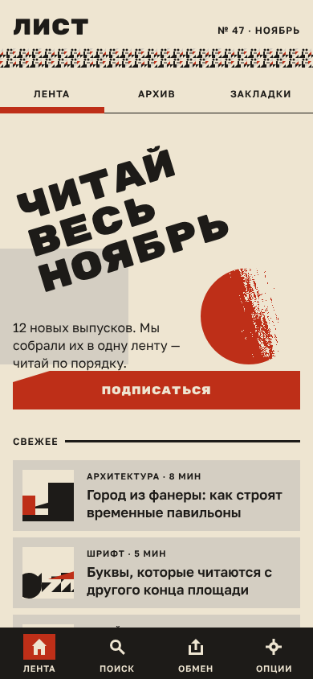
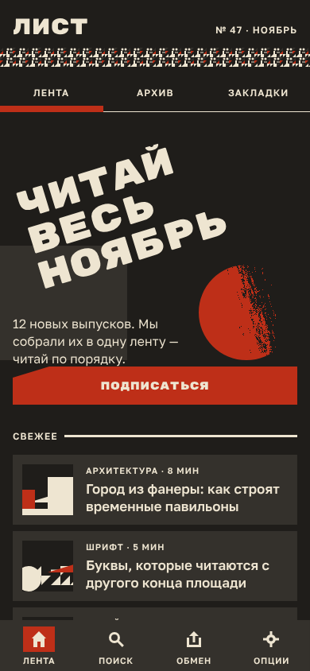
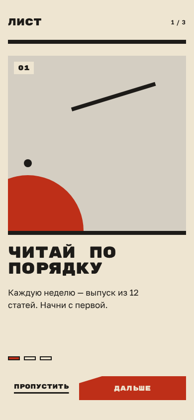

# plakat-ui

A Compose Multiplatform UI kit in the look of the Soviet avant-garde poster: big upper-case type,
red and black on paper, one diagonal axis, no decoration, and motion that rides on rails to a hard
stop. Mobile first (Android, iOS), with desktop and wasm alongside. No Material dependency.

<table>
  <tr>
    <td align="center"></td>
    <td align="center"></td>
    <td align="center"></td>
  </tr>
</table>

**[Try it in the browser →](https://youndie.github.io/plakat-ui/)** Every component on one sheet,
under both palettes and reduce motion, and the demo beside it.

Each image is a screenshot golden: what `./gradlew check` compares the code's render against on every
build, so it is what the library draws and not a mock-up. What the design draws is held to it, in
numbers against its generators run in Node and in pixels against references rendered from it in
Chrome. What it does not draw is designed here, and says so in its item.

## Using it

```kotlin
repositories {
    maven("https://reposilite.kotlin.website/snapshots") {
        mavenContent { includeGroupAndSubgroups("io.github.youndie") }
    }
}

dependencies {
    implementation("io.github.youndie:plakat-core:0.1.0.<build>")
}
```

Every build of `main` publishes a version: `<head>.<build>`, where the head is the next release. The
latest is the last `<version>` in
[maven-metadata.xml](https://reposilite.kotlin.website/snapshots/io/github/youndie/plakat-core/maven-metadata.xml).
There is no release yet.

```kotlin
PlakatTheme {
    PlakatButton("Подписаться", onClick = {})
}
```

Targets: desktop (JVM), Android, iOS (arm64 and the arm64 simulator), and wasm.

The sample app, the kit and the demo in one window: `./gradlew :sample:run`.

## Where things are

The design is frozen in [reference/design-system/](reference/design-system/), the plan is
[backlog.md](backlog.md), and the documentation is [docs/](docs/README.md). Why it is built the way
it is: [the research document](docs/research/research-architecture.md). The cost on a phone:
[the device measurements](docs/research/measurements-2026-11-05-device/).

## Licence

MIT. The bundled fonts, Rubik Mono One and Golos Text, keep their OFL.
